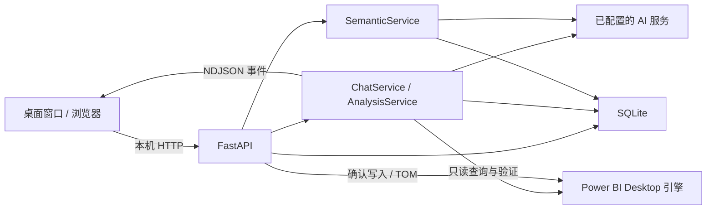

# Power BI Assistant V2 技术架构

Power BI Assistant 在本机连接 Power BI Desktop，并通过用户配置的 AI 服务处理 DAX、M 和业务分析请求。2.0.12 的构建基线为 Git 标签 `V-1.0.8.7`（`fdbb953`），包含离线使用说明、侧栏布局和会话上下文控制。2.0.13 增加 Windows 桌面在线更新。[验证记录](VALIDATION.md)

## 运行与数据流

`desktop.py` 先创建后端，再绑定 `127.0.0.1` 上的端口。原生模式在主线程运行 pywebview / Edge WebView2，在后台线程运行 Uvicorn。浏览器预览也访问这个本机服务。FastAPI 提供首页、`/assets` 下的 ES Modules 和 JSON API，生产运行直接加载 `frontend/` 中的文件。会话锁、活动任务、取消令牌和 Desktop 连接状态都属于这一后端进程。增加 Uvicorn worker 会分割这些状态。[桌面入口](../desktop.py) · [服务装配](../backend/app.py)

已安装的原生窗口通过本地 `/api/updates` 检查构建时指定的 HTTPS 清单。后端用内置发布公钥验证签名，只暂存高于当前版本的安装包。用户确认重启且工作区空闲时，后端再次校验安装包并启动 Inno Setup。安装器等待旧进程退出，在原安装位置验证和沿用本机授权，成功后启动新版。[更新服务](../backend/updates.py) · [签名协议](../backend/releases.py) · [发布流程](LICENSING.md#发布在线更新)

| 工作内容 | 从哪里读 |
| --- | --- |
| 路由、请求校验、依赖装配、静态资源 | [app.py](../backend/app.py) · [schemas.py](../backend/schemas.py) |
| 前端事件、草稿、会话切换、消息渲染 | [app.js](../frontend/app.js) · [workspaces.js](../frontend/workspaces.js) · [messages.js](../frontend/messages.js) |
| Desktop 实例发现、报表身份、结构快照、连接恢复 | [live_source.py](../backend/engine/context/live_source.py) · [reports.py](../backend/reports.py) · [powerbi.py](../backend/powerbi.py) · [reconnection.py](../backend/reconnection.py) |
| 模型服务配置、供应商适配、生成诊断 | [settings.py](../backend/settings.py) · [engine/llm](../backend/engine/llm/) · [generation.py](../backend/generation.py) |
| DAX / M 生成与验证、数据分析、数据库定义 | [chat.py](../backend/chat.py) · [validation.py](../backend/validation.py) · [analysis.py](../backend/analysis.py) · [database.py](../backend/database.py) |

## 身份与持久化

| 身份 | 持有的状态 | 开发时的用途 |
| --- | --- | --- |
| 报表身份、`model_id` | 报表名称、可获取的路径和引擎信息。`models` 保存模型结构与指纹 | Desktop 重开可能更换端口。连接先辨认报表，再核对结构。写入后同一模型记录可更新指纹 |
| `dictionary_id`、`object_id` | 词典及表、列、度量值的业务定义 | `model_dictionary_bindings` 记录模型与词典的关联及当前版本，`current_model_semantics` 用于读取。对象 ID 由种类、表名、对象名导出 |
| `conversation_id` | 工作空间、当前模型及 Power Query 目标查询 | 在原对话同步模型时，更新模型关联并保留会话 ID |
| `message_id`、`artifact_id`、`query_id` | 聊天原文、候选代码、查询证据各自持久化 | 重新验证按消息进行，写入按单个产物进行，下载 CSV 按查询取已保存的结果 |
| `view.key`、`generation_id` | 待发送草稿及附件选择属于前端页面，一次生成有独立取消令牌 | 首次发送前页面可以没有会话 ID。迟到的事件或停止请求必须归属原页面、原任务 |
| `llm_profile_id` | 协议、模型名、加密密钥、思考强度和等待参数 | 指定本次生成所用 AI 服务。报表关联由会话的 `model_id` 决定 |
| `template_id`、`request_id` | 模板版本与每次运行快照 | 同一运行请求可重试，运行结果在自己的分析对话中查看 |

SQLite 开启 WAL 和外键约束。`conversations` 与 `messages` 保存会话主线，`artifacts` 和 `audit` 记录候选代码、验证与写入结果。`analysis_queries` 保存实际查询返回的行、错误和截断标记，`field_observations` 保存字段检查。`conversation_bindings` 记录本会话已确认的口径，`conversation_model_syncs` 记录模型切换点。涉及迁移及删除时，应按实际外键与事务检查这些记录的生命周期。[数据库定义](../backend/database.py)

`PBI_DATA_DIR` 可覆盖数据目录。默认源码使用项目 `data/`，安装版使用 `%LOCALAPPDATA%\PowerBIAssistant`。迁移机器或排查密钥解密失败时，先关闭应用，成套保留 `assistant.sqlite3` 和 `secret.key`。对话、图片和已保存的查询行都属于用户数据。[目录选择](../backend/app.py) · [配置存储](../backend/settings.py)

## 报表连接、快照与同步

1. **连接报表。** `POST /api/models/connect` 从实际 Desktop 实例核对端口，使用 ADOMD 读取表、列、度量、关系和 M 查询。报表身份与结构匹配时可以复用原 `model_id`。结构变化时可以创建新快照并将原词典关联到新快照。连接触发本地语义对齐，AI 梳理由单独的构建请求启动。[模型连接](../backend/powerbi.py) · [语义对齐](../backend/semantics.py)
2. **恢复连接。** `GET /api/models/{model_id}/connection` 提供界面状态。后台定期尝试核对已有报表。同名候选有歧义时返回 `ambiguous`，结构不同返回 `changed`。真正执行 Desktop 任务前仍会调用 `require_live(..., unchanged=True)`。失败时保留原因并停止当前受影响操作。[重连](../backend/reconnection.py) · [前端监控](../frontend/connections.js)
3. **释放旧结构。** 成功连接或同步后，本机只保留最近的完整 Desktop 结构。释放过程在事务中保存签名、清理旧取值缓存并将旧 `context` 置空。旧对话和语义词典可继续查看。旧模型有生成或梳理任务时，切换可能返回 `409`。[快照管理](../backend/powerbi.py) · [快照回归](../tests/test_snapshot_retention.py)
4. **同步当前对话。** 已有会话调用 `POST /api/conversations/{conversation_id}/refresh-model`。`ChatService.refresh_model()` 持有会话锁、核对 Desktop，在同一数据库事务中更新会话关联和同步边界，并清理失效的列绑定。前端保留原 `view`、图片、草稿和历史消息，旧助手回复按边界标记 `model_stale`。无持久化会话时才直接调用 `POST /api/models/{model_id}/refresh`。[会话同步](../backend/chat.py) · [前端接线](../frontend/app.js)

手动另选报表走 `useModel()`。当前端尚无已发送消息，且此前没有模型，首次选择会将所选模型交给原草稿。未发送的分析草稿从示例切到真实报表也按此处理。切换已有报表的操作可新开对话。同步原对话有独立路由和前端回调，测试时应分别覆盖。[导航回归](../tests/app_navigation.test.mjs) · [会话同步回归](../tests/test_conversation_sync.py)

## 语义词典、搜索与字段证据

模型事实来自 `ModelContext` 和 Desktop 元数据。语义对象另存业务名称、含义、单位、角色、别名、用途和审阅状态。词典用 `inventory / building / ready / error` 表示梳理进度，对象用 `unresolved / candidate / confirmed` 表示定义状态。真实模型的 DAX 和数据分析按 `can_answer` 判断是否具备可用解释。旧词典正在增量更新时可以沿用已有定义，首次仍无可用解释时会要求建立词典。Power Query 可直接使用查询结构。[模型上下文](../backend/engine/context/base.py) · [状态与就绪判断](../backend/semantics.py)

- **更新与历史关联。** 对象变更由 `semantic_diff.py` 检测，受影响的旧定义可保留供复核。业务总览、术语、约定及其对象和筛选引用由 `business_dictionary.py` 维护。词典名称只是显示名称，关联依赖报表身份和结构。命名、删除、复用及差异预览集中在词典目录服务。编辑时保留版本或更新时间校验，避免覆盖别人在预览后提交的修改。[增量比较](../backend/semantic_diff.py) · [业务词典](../backend/business_dictionary.py) · [词典目录](../backend/dictionary_library.py)
- **跨机器迁移。** `GET /api/models/{model_id}/semantics/export` 导出带格式标识和版本的 JSON，包含对象定义、业务总览、术语与约定。向同一路径前缀的 `import-preview` 和 `import?updated_at=…` 分别 POST 文件内容，二者走同一合并逻辑。结构与可比较的元数据签名兼容时，匹配对象可采用文件定义。不兼容时保护目标已审阅定义，其他匹配项标为待复核。缺失对象跳过，目标词典已变更时返回 `409` 并要求重新预览。模型事实仍由当前 Desktop 提供。[迁移协议](../backend/semantic_transfer.py) · [导入回归](../tests/test_semantic_transfer.py)
- **侧栏找字段。** 结构页由 `modelTree()` 在本机的表、列、度量值中查找。模型摘要携带已确认定义的 `search_names`，包含对象键、业务名称和别名。用户按别名搜索时，第一行用于辨认业务对象，第二行展示技术引用。点击插入正确转义的 DAX 名称，字段预览按原始表名和列名查询。这里的匹配不需要模型服务参与。[字段树](../frontend/model_tree.js) · [语义编辑与摘要](../frontend/semantics.js)
- **为模型选上下文。** `semantic_retrieval.py` 根据当前问题、历史与会话绑定检索，按预算扩展相关对象、关系和依赖。`ModelPrompt` 合并结构事实和所选语义。数据分析可按需补查词典。字段值、编号归属和筛选范围需要查询证据或用户确认，候选名称本身不能证明业务值确实存在。[语义检索](../backend/semantic_retrieval.py) · [提示词组装](../backend/model_prompt.py) · [范围校验](../backend/scope_checks.py)

字段预览 `POST /api/models/{model_id}/fields/preview` 读取指定列的统计或取值，适合核对当前模型实际数据。分析规划另可请求样例、模糊查值或精确口径检查。缓存复用需考虑结构、完整性和范围。发生截断、权限错误或超时时，保留检查状态，避免把未查到解释为数值零。[字段预览](../backend/fields.py) · [分析查值](../backend/field_discovery.py) · [值证据](../backend/values.py) · [确认卡](../backend/clarifications.py)

## 一次生成的执行路径

发送入口为 `POST /api/conversations/{conversation_id}/messages`，响应使用按行分隔的 JSON。`ChatService.begin()` 读取会话与附件、核对模型和目标查询、检查校准筛选、获取会话锁并注册取消令牌。`dax` 和 `mquery` 进入代码生成，`analysis` 进入只读数据分析。后端选择允许的执行动作，AI 提供候选代码或结构化计划。[聊天编排](../backend/chat.py) · [路由与响应](../backend/app.py)

### 生成代码、验证和确认写入

| 工作空间或对象 | 验证怎样发生 | 结果如何落地 |
| --- | --- | --- |
| Power Query | 依据指定查询、输出字段、相关共享查询与参数生成 M，并做静态检查 | 用户复制到 Desktop 高级编辑器后应用和刷新 |
| DAX 度量值 | 先静态核对引用，再用查询作用域临时度量在真实 Desktop 实跑。校准针对回复中最后一个度量值，比较最多 10 个筛选条件同时生效时的实际值和一个期望值，按绝对容差判定 | 用户审阅名称、存放表和公式。同表同名度量需明确允许覆盖 |
| DAX 计算表 | 在引擎中验证表表达式 | 确认后只支持新建，已存在的同名表会阻止写入 |
| DAX 计算列 | 在所属表的行上下文中抽样，最多 50 行、20 秒 | 确认后通过 TOM 创建并执行完整计算。样本通过仍可能在完整计算时遇到依赖或类型错误 |

`validation.candidates()` 从回复解析候选对象，同次生成最多 20 个。代码验证失败时，编排允许最多两轮自动修复。连接失败时先恢复连接。`POST /api/messages/{message_id}/validate` 可重新实跑已保存的 DAX 产物。当前工作区将 DAX 的“校准”放在快捷任务行右侧，前端继续提交相同的校准数据结构。[验证与校准](../backend/validation.py) · [实跑求值](../backend/engine/dax/live_eval.py) · [校准表单](../frontend/calibration.js)

`POST /api/artifacts/{artifact_id}/apply` 是物理模型写入入口。后端要求原产物 `ok` 且 `run_verified`，随后持有 Desktop 锁，重新读取产物所属会话的**当前模型**，用用户最终选择的名称和表检查冲突并重新验证。TOM 返回结果后记录 `write_model` 审计。成功时更新 `applied_at` 和模型上下文。写入成功但读取新结构失败时，返回“已写入、需手动同步”的提示。报表文件仍由用户在 Desktop 中保存。[写入路由](../backend/app.py) · [TOM 写入器](../backend/engine/context/live_writer.py) · [目标与覆盖回归](../tests/test_write_target.py)

### 数据分析与模板

`analysis.py` 依次负责规划、补查语义或字段、澄清口径、执行只读 DAX、按证据总结。`AnalysisPlan` 明确约束每个阶段可以返回的动作。格式无效时，普通请求最多再纠正一次，整轮最多三次。整批失败后的替代查询评估仅一次，另需核对错误原因和新的取数依据。无法得到有效结果时，保存已取得的依据及缺口。[分析编排](../backend/analysis.py) · [计划协议](../backend/analysis_protocol.py) · [失败恢复](../backend/analysis_recovery.py)

执行器仅接受单个 `EVALUATE` 结果集，可使用 `DEFINE` 声明查询内度量。`AnalysisBudget` 为总结保留时间，另设每批最多 4 条、每轮最多 4 批和 12 条业务查询、最多 18 次应用执行尝试。每个成功结果最多保留 200 行和 24,000 字节行数据，截断信息随结果保存。超过 30 列的查询返回错误。分析表格、查询依据和 `GET /api/analysis/{query_id}/csv` 复用本次保存的结果。报表页面切片器的条件需要显式写入任务。[执行预算](../backend/analysis_budget.py) · [只读边界测试](../tests/test_analysis_boundaries.py) · [表格阅读](../frontend/table_reader.js)

模板复用分析任务文字和口径。参数识别位于 `template_parameters.py`，运行时按本次输入、上次实际取值、模板默认值的顺序填入 `{{参数}}`。`POST /api/analysis-templates/{template_id}/runs` 校验模板 `revision` 和报表身份，事务内建立新分析会话和参数快照，再调用 `ChatService.begin()` 重新查询。相同 `request_id` 和请求内容返回同一运行，不同内容复用同一 ID 会得到 `409`。删除模板和删除历史会话属于不同操作。[模板参数](../backend/template_parameters.py) · [模板服务](../backend/analysis_templates.py) · [模板界面](../frontend/analysis_templates.js)

## 流式更新、恢复和取消

- **传输。** `completion_events()` 从供应商读取增量内容并追踪实际活动、空闲和总时限。`BackgroundStream` 单独消费后端生成器，对外提供有界队列。HTTP 读者断开、切换页面或跟不上队列时，服务继续写入 SQLite。前端通过会话消息和 `/generation` 获取进度。向界面发送的心跳与供应商输出分开计时。[流处理](../backend/streaming.py) · [前端事件解析](../frontend/stream.js)
- **页面归属。** `createWorkspaces()` 隔离每个页面的消息、文字、图片和校准点。`createGenerationManager()` 跟踪原任务并在恢复时合并快照。输入预检、图片上传、模型同步和后台任务可能在切换页面后才返回，更新时要核对原 `view` 和模型。增量消息渲染保留已经展开的代码与证据区域。[工作区状态](../frontend/workspaces.js) · [消息绘制](../frontend/messages.js)
- **显式停止。** `POST /api/conversations/{conversation_id}/cancel` 必须携带对应 `generation_id`，以免迟到的取消请求误停下一轮。令牌传播到模型流和受支持的阻塞操作，终态保存已收到的内容，释放会话锁。进程关闭后内存线程结束。重启读取到缺少活动任务的 `streaming` 消息时，标为中断，模板运行也会标记为中断。[取消令牌](../backend/cancellation.py) · [后台回归](../tests/test_background_generation.py)

## 模型服务与生成诊断

模型配置由 `SettingsService` 持久化。OpenAI 兼容和 Anthropic Messages 使用各自的流式适配器，思考强度根据供应商和模型能力映射。接入新模型时，从接口类型、模型 ID、输出额度和等待参数入手。两种适配器向编排层提供统一的正文增量、活动与结束信息。[OpenAI 兼容适配器](../backend/engine/llm/openai_compat.py) · [Anthropic 适配器](../backend/engine/llm/claude.py) · [思考能力映射](../backend/engine/llm/reasoning.py)

默认输出额度为 16,000 token，流式调用默认无数据等待 90 秒、总时限 900 秒，具体采用该服务配置。供应商的思考帧可刷新活动时间。界面只显示供用户阅读的正文。排查“等待很久后没有答案”时，用 `llm_generations` 的阶段、尝试编号、耗时、用量、停止原因及诊断区分输出耗尽、无数据超时和格式错误。记录不保存内部思考正文。[流式计时](../backend/streaming.py) · [诊断结构](../backend/engine/llm/diagnostics.py) · [持久化](../backend/generation.py)

## 接口与排错入口

运行实例的 `/api/docs` 给出完整路由与请求结构。下表列出适合开始定位问题的入口，统一带 `/api` 前缀。[路由定义](../backend/app.py)

| 现象 | 先查接口或记录 | 对照回归 |
| --- | --- | --- |
| 本地服务无法打开、模型配置测试失败 | `GET /health` 区分本机服务健康与供应商可达性。`POST /llm/profiles/{profile_id}/test` 验证指定服务。用 `llm_generations` 的阶段、耗时、结束原因排查超时或空结果 | [模型配置](../tests/test_llm_profiles.py) · [生成诊断](../tests/test_generation_diagnostics.py) |
| Desktop 已打开但模型显示等待、同步后历史丢失 | `GET /desktop/instances`、`GET /models/{model_id}/connection`，核对报表身份、快照状态和原 `conversation_id` | [重连](../tests/test_reconnection.py) · [同步](../tests/test_conversation_sync.py) |
| 输入别名搜不到、导入后定义改变 | `GET /models/{model_id}` 的 `semantics.search_names`、`GET /models/{model_id}/semantics`、导入预览时间戳 | [模型树](../tests/model_tree.test.mjs) · [增量语义](../tests/test_semantic_incremental.py) · [语义迁移](../tests/test_semantic_transfer.py) |
| 查询选错字段、结果缺少筛选、计划格式错误 | 检查对应消息的字段观察、确认卡、`analysis_queries` 和诊断中的 `format_validation` | [口径校验](../tests/test_scope_checks.py) · [分析协议](../tests/test_analysis_protocol.py) · [恢复](../tests/test_analysis_recovery.py) |
| 切换标签后草稿或进度错位、停止作用在另一轮 | 同时核对会话 ID、`generation_id` 及前端 `view`，对比 `GET /conversations/{conversation_id}/messages` 与 `GET /conversations/{conversation_id}/generation` | [页面导航](../tests/app_navigation.test.mjs) · [取消](../tests/test_cancellation.py) |
| 模板重试创建重复分析、写入目标不对 | 前者核对 `request_id` 和模板 `revision`，后者核对会话当前模型与确认时选定的目标 | [分析模板](../tests/test_analysis_templates.py) · [计算列](../tests/test_calculated_columns.py) · [目标校验](../tests/test_write_target.py) |

开发环境的全量命令为 `.\.venv\Scripts\python.exe -m pytest -q` 和 `npm test`。真实环境另有独立入口，例如桌面窗口启动、实际引擎读取和授权发布检查。默认自动化用例、真实 Desktop 读写和安装包构建各有验证记录。涉及真实模型的脚本应先确认报表、数据目录及写入范围。[原生窗口冒烟](../tests/smoke_desktop.py) · [实际引擎读取](../tests/live_smoke.py) · [授权发布](LICENSING.md) · [验证记录](VALIDATION.md)

## 运行边界

查询和验证通过 Desktop 提供的 ADOMD 客户端访问本机分析引擎。模型写入使用 TOM 程序集，首次缺少本地 DLL 时会按需从固定版本的官方 NuGet 包获取并缓存。遇到“能查询、写入时找不到组件”，可单独检查 TOM 缓存和下载连接。[Desktop 读取](../backend/engine/context/live_source.py) · [TOM 组件加载](../backend/engine/context/amo.py)

应用监听本机回环地址。HTTP 中间件校验 Host、跨站请求、写入请求类型与大小。安装版还检查授权状态。配置的 AI 服务可按任务收到结构、M 或 DAX 代码、相关业务语义、对话、已选图片和查询证据。图片先在本地校验、规范化并暂存，发送后与消息绑定。对外服务故障时可检查生成诊断、实际配置和等待参数。本地连接故障则查 Desktop 实例和报表状态。两条链路独立。[中间件](../backend/app.py) · [图片读写](../backend/images.py) · [诊断记录](../backend/generation.py)

构建由 PyInstaller 收集 Python 与 `frontend/`，Inno Setup 生成安装包。修改源码或运行测试只改变工作目录中的内容。交付时核对安装包版本、构建依据和哈希。签发、升级、安装验证的操作说明独立维护。[打包定义](../packaging/powerbi.spec) · [构建脚本](../scripts/build_desktop.py) · [发布说明](LICENSING.md)
